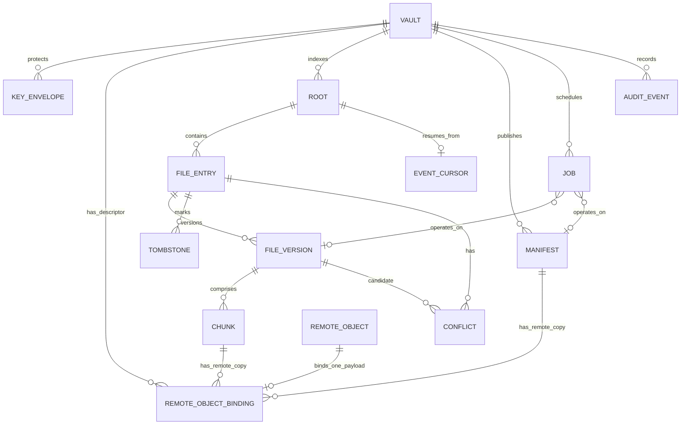
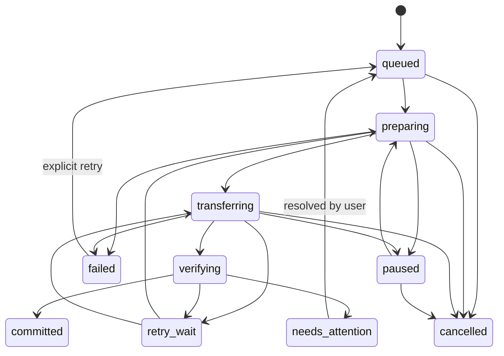
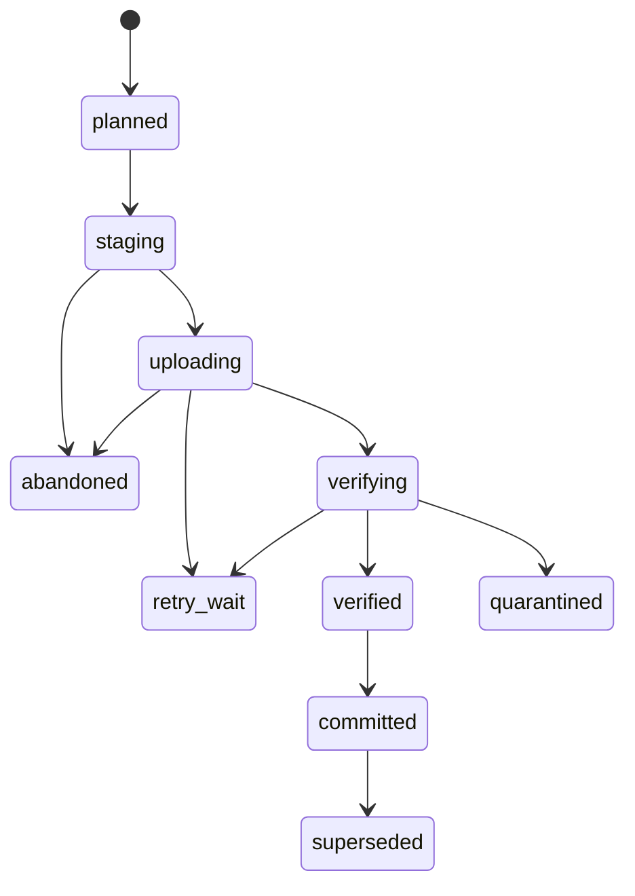
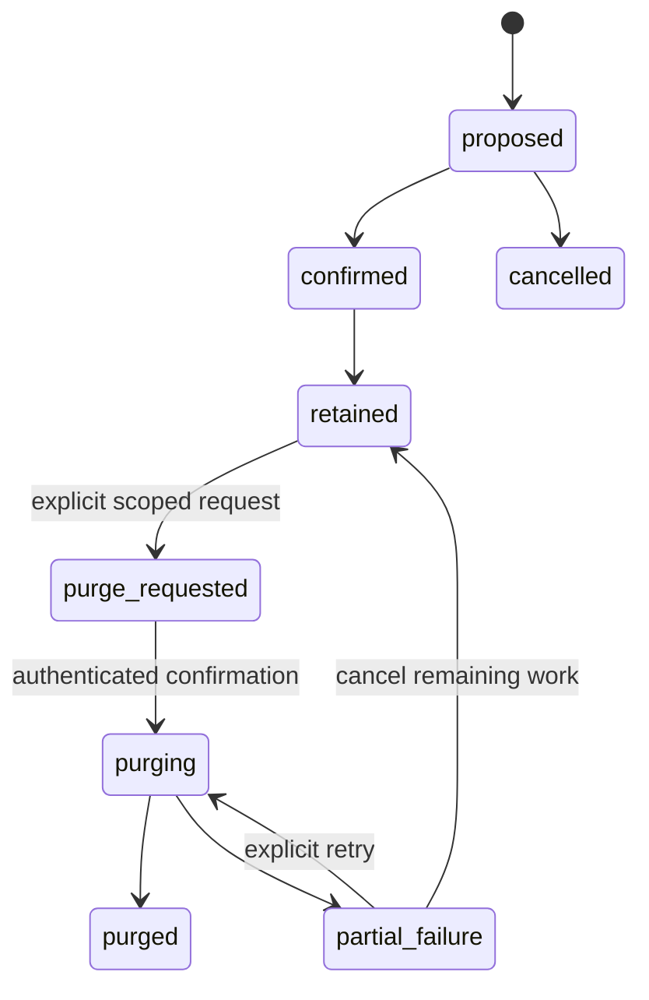

# SQLite Logical Schema, Transactions, and State Machines

Status: logical Phase 0 schema specification; not executable SQL and not implemented.

## Relationship diagram

`REMOTE_OBJECT_BINDING` is a typed, logical relationship: exactly one of the `CHUNK`, `MANIFEST`, or `VAULT` target relationships applies per row. The diagram shows the possible relationships, not three simultaneous nullable foreign keys. `VAULT` binding is for a descriptor only. The common binding table is preferred over three association tables plus cross-table exclusivity triggers because its primary key expresses one binding per physical object directly; the alternative could be enforced with coordinated triggers but duplicates lifecycle/state definitions and is harder to audit. Both designs need implementation-level constraint tests; neither has been implemented.

## Tables and key constraints

All IDs are opaque UUIDs (binary 16-byte canonical representation or fixed lowercase text; choose one before schema v1). Timestamps are UTC integer milliseconds. Foreign keys are enabled on every connection and checked at startup. Sensitive values are excluded or encrypted as indicated.

| Table | Key columns / relationships | Invariants |
|---|---|---|
| `vault` | `vault_id` PK; active crypto-epoch UUID; format/schema version; state | One active writer; no plaintext secret. |
| `key_envelope` | `envelope_id` PK; `vault_id` FK; crypto-epoch UUID; kind; format; KDF metadata; salt/nonce/ciphertext | Wrapped key material only; recovery secret and plaintext VMK never stored. |
| `root` | `root_id` PK; `vault_id` FK; local path or protected representation; permission/state | Path exposure minimized; root identity and scan state explicit. |
| `file_entry` | `file_id` PK; `root_id` FK; encrypted/protected relative path; presence | Stable identity distinct from path; unique active path within root. |
| `file_version` | `version_id` PK; `file_id` FK; immutable metadata; plaintext size/hash local only; state | Once committed, immutable; no plaintext content. |
| `chunk` | PK `(version_id, chunk_index)`; `version_id` FK; derivation salt/context; nonce; ciphertext size/digest; wrapped DEK ref; state | Ordered, bounded; one-use AEAD key per chunk; no plaintext chunk bytes. A chunk reaches `remote_committed` only when at least one matching `remote_object_binding` for payload type `chunk` is `confirmed`. |
| `remote_object` | `remote_object_id` PK; kind (`chunk`, `manifest`, or `descriptor`); channel locator; message ID; opaque object ID; observed metadata | No token/session; locator may become unavailable and is not content truth. Kind is immutable once bound; one object can have at most one binding. |
| `remote_object_binding` | `remote_object_id` PK and FK to `remote_object`; payload type and exactly one target identity: chunk `(version_id, chunk_index)`, manifest `(vault_id, generation)`, or descriptor `vault_id`; confirmation state/time | Common binding entity selected to enforce physical-object exclusivity. Target FKs are restrictive. The same logical target can have multiple remote IDs (copies); one remote ID cannot point to multiple payloads or categories. |
| `manifest` | PK `(vault_id, generation)`; crypto epoch UUID; parent; ciphertext digest; state | Commit record references only verified chunks; generation continues above trusted checkpoint across epochs. Remote publication is represented by a `remote_object_binding` with payload type `manifest`. |
| `nonce_reservation` | reservation ID; root key UUID; crypto epoch; derivation salt/context; derived-key identifier; nonce; operation ID; state; staged ciphertext locator/digest | Unique root/salt/context and derived-key/nonce tuple in current DB; never clear spent/ambiguous reservation. This table cannot alone protect against restoring an older DB snapshot. Proposed v2 uses one-use derived AEAD keys so post-rollback encryption requires fresh salt/context/IDs, even when trusted VMK remains. |
| `job` | `job_id` PK; type; entity refs; idempotency key unique; state; attempts; retry time | Durable intent precedes side effects; errors sanitized. |
| `conflict` | conflict ID; file ID; competing version refs; state; reason code | Both candidates preserved until user resolution; resolution does not purge. |
| `tombstone` | tombstone ID; file ID; path/version ref; generation; state | Logical deletion only; no automatic remote deletion. |
| `event_cursor` | root ID PK/FK; cursor value; full-scan-needed flag | Advisory only; invalidation forces scan. |
| `app_setting` | key/value | Non-secret settings only. |
| `audit_event` | event ID; timestamp; action/result; redacted scope | No secrets, file content, or unnecessary plaintext paths. |
| `schema_migration` | version PK; checksum; applied timestamp | Append-only migration history; checksum mismatch stops startup. |

### Remote-object exclusivity invariants (proposed logical schema)

Option A (one common binding table) is selected for this logical proposal over option B (three association tables requiring cross-table exclusivity triggers). A single `remote_object_binding.remote_object_id` primary key makes one-binding-per-physical-object structural. The binding contains `payload_type` plus nullable target columns for the three possible targets. Exactly one target group must be entirely populated, and it must correspond to the payload type: `chunk` uses `(version_id, chunk_index)` and a composite FK to `chunk`; `manifest` uses `(vault_id, generation)` and a composite FK to `manifest`; `vault_descriptor` uses `vault_id` and an FK to `vault`. All other target columns are NULL. The logical CHECK rule must reject partial or multiple groups. All target and remote-object FKs use restrictive deletion; no cascade is allowed for historical backup objects.

The target and payload type are immutable after binding, except through a separately specified, explicit purge workflow; ordinary update/rebinding is rejected. Kind mapping is exact: binding `chunk` → `remote_object.kind=chunk`; `manifest` → `manifest`; `vault_descriptor` → `descriptor`. A required insert/update trigger validates this mapping; a complementary trigger rejects changing a bound object's kind. Exact SQL is deferred to a reviewed, versioned migration. `remote_object_id` PK permits multiple different remote objects for the same logical target, preserving multiple copies while preventing one remote object from being claimed by two payloads. Pending rows may exist before upload; only `confirmed` rows count as remote references.

Uniqueness: one vault UUID; one generation per vault; one chunk index per file version; one idempotency key per job; no duplicate active `(root_id, relative_path)`; one binding per remote object. Exact partial indexes and exact trigger bodies are later SQL design work. SQLite foreign keys must be enabled on every connection; referential integrity is enforced by declared FKs and binding type/exclusivity rules by CHECK/trigger proposals. See [SQLite foreign-key documentation](https://www.sqlite.org/foreignkeys.html) and [SQLite CREATE TRIGGER documentation](https://www.sqlite.org/lang_createtrigger.html). This remains a logical proposal, not executable SQL or an approved migration.

## Transaction boundaries

- **Job creation:** one short transaction records job intent, idempotency key, planned FileVersion, and chunk plan before filesystem/network work.
- **Chunk acknowledgement:** before upload, create a local remote-object placeholder and pending binding for the chunk in a short transaction. After response validation, update the locator and mark the binding confirmed; only then can the chunk become `remote_committed`. Never hold a DB transaction across file I/O or Telegram RPC.
- **Manifest commit:** validate the decrypted manifest's referenced chunk identities against confirmed chunk bindings; the encrypted membership list is not a relational FK set. Then create a pending manifest binding, publish the encrypted manifest, and validate its remote reference. A short transaction marks the binding confirmed and the manifest committed. Remote publish occurs before local commit; if local commit is ambiguous after crash, reconcile the pending binding against the remote manifest before retry.
- **Restore:** DB reads plan work; network/decrypt happens outside long transactions. Final status commits after atomic filesystem rename; startup reconciles filesystem marker after crash.
- **Migration:** exclusive service lock; snapshot before migration; migration runs transactionally where supported, and records version/checksum atomically. Non-transactional transforms use staged copy and atomic swap, never partial in-place rewrite.
- **Purge:** preview graph is persisted as a purge job; no remote delete until separate explicit confirmation; each outcome is recorded; partial failure remains resumable and visible.

## Job state machine

`committed`, `cancelled`, and terminal `failed` are terminal for that attempt; retries create a new attempt or explicitly reset with audit evidence. Cancellation cannot undo an acknowledged remote side effect; reconcile before retry/cleanup. Persist error class, attempts, retry due time, and safe progress.

## FileVersion state machine

Committed versions are immutable. `superseded` does not mean deleted. A version cannot commit if any required object or manifest validation is missing. Quarantined data remains available for diagnosis and is not auto-purged.

## Tombstone and purge state machines

`confirmed` requires complete local reconciliation and policy grace criteria. `retained` preserves all versions and remote objects. Purge is irreversible, user-confirmed, graph-scoped, and reports objects Telegram did not confirm deleting. No timer transitions to purge.

## Migration and recovery strategy

Use monotonic schema versions with immutable migration files and checksums; never skip a version or edit an applied migration. At startup: acquire process lock; validate DB integrity and migration history; create pre-migration snapshot using SQLite Online Backup API or equivalent safe mechanism; migrate; run foreign-key/integrity checks and application invariants; only then mark service ready. If migration fails, preserve original and snapshot, stop service, and present recovery instructions; no auto-downgrade.

Back up DB before migration and periodically through a consistent SQLite backup mechanism. Snapshot contains sensitive metadata and must use user-only permissions; it is not uploaded to Telegram by default. Define cleanup only for local migration snapshots with an explicit bounded policy distinct from backup retention; never silently remove the only known-good copy.

On corruption: stop writes, preserve DB/WAL/SHM copy for local recovery diagnostics with strict permissions, and do not mutate in place. Rebuild into a new DB from verified manifests and local data only under a user-visible recovery action. If no verified source exists, report incomplete rebuild and retain damaged DB copy. Do not claim complete recovery until counts and manifest chain reconcile.

The anti-rollback trusted head is stored independently in Keychain and may also be exported as the proposed HMAC checkpoint described in `CRYPTO_AND_RECOVERY.md`; a DB copy is informational only. If DB rollback is detected or suspected, pause encryption even when manifest head/checkpoint appear unchanged: those values do not prove an uncommitted wrapper was never encrypted. Never repeat any old salt/context/derived-key/nonce tuple. Under proposed v2, retain a trusted VMK only as HKDF input material and require fresh CSPRNG salts/operation IDs and one-use derived AEAD keys; direct VMK-as-GCM use is prohibited. Preserve all committed old envelopes for decryption. If trusted VMK integrity or entropy cannot be established, remain read/restore-only until an independently reviewed key-rotation/recovery procedure. If trusted head itself is absent/rolled back, remain read/restore-only pending explicit reviewed branch/recovery decision.

## Required tests before implementation acceptance

Migration from each supported version; checksum mismatch; interruption at every migration boundary; foreign-key enforcement per connection; competing writer/SQLITE_BUSY; crash around remote/local commit boundary; stale lock; DB corruption preserving original; illegal state transitions; purge partial failure/retry without automatic deletion.
